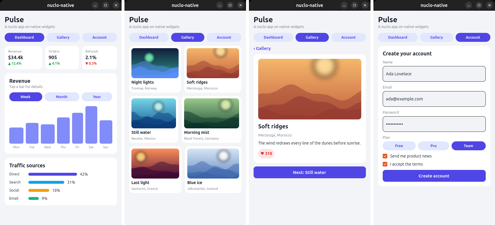
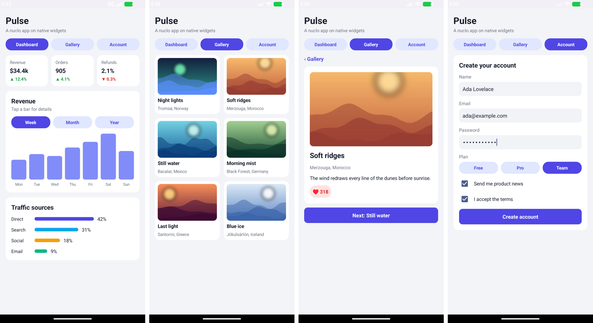

# nuclo-native (POC)

Write a normal nuclo app. It renders with real native widgets — no webview — on Android, iOS, macOS, Windows and Linux, and builds as a web app (SPA and installable PWA) from the same source. The same bundle also runs on a GPUI host that draws every platform itself.

Navigation is each platform's own: `UINavigationController` and a tab bar on iOS, a sidebar and toolbar on macOS, Material motion and predictive back on Android, libadwaita on Linux, a Fluent nav pane on Windows.

```ts
import "nuclo-native";

let count = 0;

const App = () =>
  div(
    { style: { padding: 24, gap: 16 } },
    h1(() => `Count: ${count}`),
    button("Increment", { onClick: () => { count++; update(); } }),
  );

render(App, document.body);
```

The showcase app (`example/app.ts`) on Linux, GTK 4:



The same bundle on Android, platform Views:



## The showcase

`example/app.ts` is a three-tab app built only from nuclo calls and inline styles:

- **Dashboard** (`/`): stat cards, a bar chart that resizes when you switch Week / Month / Year and highlights the bar you tap, and horizontal share bars. Charts are plain views with a `height` or `width`, so they need no canvas.
- **Gallery** (`/gallery`, `/gallery/:id`): an image grid that pushes a detail screen with a route parameter and a like toggle.
- **Account** (`/account`): text, email and password fields, a segmented choice, checkboxes, validation messages and a success state.

## Navigation

`nuclo-native/router` is a stack router whose screens, stacks and tabs the host shows with the platform's own navigation:

```ts
import { createRouter } from "nuclo-native/router";

export const router = createRouter(
  {
    "/": { view: Dashboard, title: "Pulse" },
    "/gallery": { view: Gallery, title: "Gallery" },
    "/gallery/:id": { view: PhotoDetail, title: ({ id }) => photoTitle(id) }, // receives { id }
  },
  {
    tabs: [
      { path: "/", title: "Dashboard", icon: "chart" },
      { path: "/gallery", title: "Gallery", icon: "photo" },
    ],
  },
);

render(router.outlet, document.body); // the app's navigation is its root

router.go("/gallery/dunes"); // push onto the current tab's stack
router.back();               // pop
router.reset("/");           // select the tab that owns "/" and pop it to its root
```

A route is a view, or `{ view, title }` where the title is the navigation bar's. Each tab keeps its own stack. Icons are semantic names (`chart`, `photo`, `person`) each host maps to its icon set.

| Target | Tabs | Push / pop | Back |
| --- | --- | --- | --- |
| iOS | `UITabBarController` | `UINavigationController`, large titles on root screens | back button, interactive edge swipe, re-tap the tab |
| macOS | source-list sidebar (`NSSplitViewController`) | slide (`NSViewController` transition), the window title is the screen's | toolbar chevron, ⌘[, two-finger swipe |
| Android | Material 3 bottom bar, fade through | Material shared axis X | toolbar arrow, back key, predictive back gesture (API 34+), re-tap the tab |
| Linux | `Adw.ViewStack` + `Adw.ViewSwitcherBar` | `Adw.NavigationView` | header bar back, swipe, Alt+←, mouse back |
| Windows | Fluent nav pane | drill-in | back button, Alt+←, mouse back |
| Web | bottom tab bar | directional view transitions | bar back button, browser back (its own swipe-back animation is kept) |

JS owns the state; the host owns the UI. When the user goes back natively, the host pops first and reports `pop` with the depth left; the router follows. On the web the route lives in the URL hash (`#/gallery/dunes`) and the browser history is the stack, so links, reloads and the back button work on any static host; switching tabs there resets the tab.

`nuclo-router` itself needs `URL`, `history` and `location`, which the bare JS engines do not have.

`example/todo.ts` is the smaller counter and todo example.

## How it works

```
your app + nuclo (unmodified)
        │  DOM calls
        ▼
src/dom.ts — a ~370-line "native DOM"
        │  one JSON batch of ops per render()/update()
        ▼
host (one small file per platform) → native widgets
        │
        └─ events back: __nuclo_event(id, type, value)
```

nuclo already updates the DOM directly, with no virtual DOM. So the native DOM only records what nuclo does. There is no tree diff, no reconciler and no shadow tree. A counter click sends one op: `["set", 6, "text", "Count: 1"]`.

The whole host contract is six ops and one callback:

| Op | Meaning |
| --- | --- |
| `["create", id, kind]` | `view`, `text`, `button`, `input`, `checkbox` or `image`; navigation: `tabs`, `stack`, `screen` |
| `["insert", parentId, id, beforeId]` | Insert or move. `beforeId` 0 appends. |
| `["remove", id]` | Detach and destroy the subtree |
| `["set", id, key, value]` | `text`, `value`, `checked`, `placeholder`, `type`, `disabled`, `src`; `title` (screen, or a stack's tab), `icon` (a stack's tab), `selected` (tabs) |
| `["style", id, key, value]` | A camelCase CSS subset |
| `["listen", id, type]` | `click`, `input`, `change` |

The host exposes `__nuclo_host(json)` and calls `__nuclo_event(id, type, value?)`: `click`, `input` (value: text), `change` (value: checked), `pop` on a stack (value: depth left after a native back) and `select` on the tabs (value: index). Both take only strings and numbers, so any JS engine can bridge them.

Navigation: screens go into stacks, stacks into tabs, and a tabs or stack inserted into the body is the window's root navigation. At the end of each batch the host compares every stack with what it shows: a new top screen is a push, a removed top screen a pop, both animated the platform's way.

Only nodes attached under `document.body` exist natively. Trees built off-document, `list()` templates and comment markers send nothing until they are attached.

## Hosts

| Target | Host | JS engine | Drawn with | Status |
| --- | --- | --- | --- | --- |
| `ios` | `hosts/apple` | JavaScriptCore | UIKit | Simulator: tabs, push, edge-swipe and button back, re-tap to root, JS kept in sync |
| `macos` | `hosts/apple` | JavaScriptCore | AppKit | Ran scripted: sidebar, toolbar back, titles, push/pop, JS in sync. Trackpad swipe and ⌘[ not exercised |
| `android` | `hosts/android` | QuickJS-NG (NDK) | Android Views | API 37 emulator: tabs, push, back key, edge swipe with the predictive-back card, up arrow, re-tap, ripples |
| `linux` | `hosts/linux/host.js` | GJS | GTK 4 + libadwaita | Ran on macOS (Homebrew GTK): tabs, push, native back with JS sync. Swipe and Alt+← not driven |
| `windows` | `hosts/windows` | Jint | WPF (Fluent) | Compiles with the .NET 11 SDK, 0 warnings. Never launched |
| `web` | `hosts/web` + `src/web.ts` | the browser's | the DOM | Browser: push, pop and tab transitions, back button, URL |
| `ios-gpui` | `hosts/gpui` | QuickJS (rquickjs) | GPUI via gpui-mobile (Metal) | Simulator: tabs, push, interactive edge swipe, back button, JS in sync. The other four looks previewed with `NUCLO_LOOK` |
| `macos-gpui` | `hosts/gpui` | QuickJS | GPUI (Metal) | Runs, no JS errors. Not screenshotted (no screen-recording permission); same renderer as `ios-gpui` |
| `android-gpui` | `hosts/gpui` | QuickJS | GPUI via gpui-mobile (Vulkan) | Builds; on the emulator the bundle runs, but no emulator GPU can run GPUI's renderer (GLES 3.0 lacks compute, its Vulkan is non-conformant). Needs a device |
| `linux-gpui` | `hosts/gpui` | QuickJS | GPUI (Vulkan) | Builds and links in a Debian container (arm64); opens its X11 window, picks Vulkan (Mesa lavapipe) and runs the bundle. Not seen drawing: under Xvfb GPUI presents no frames, its own hello world included. Needs a Linux desktop |
| `windows-gpui` | `hosts/gpui` | QuickJS | GPUI (DirectX) | Cross-built from macOS with MinGW (GNU ABI): compiles and links `nuclo-gpui.exe`. Never launched |

## GPUI

`hosts/gpui` is one Rust crate for all five GPUI targets. QuickJS runs the bundle; the crate keeps the op tree and draws it with GPUI each frame. GPUI draws its own pixels, so the router's navigation is drawn the platform's way (`src/look.rs`): the iOS floating tab bar, large titles, parallax push and edge swipe; Material 3 bars and shared-axis motion; the macOS sidebar and toolbar; the Fluent nav pane and drill-in; the Adwaita header and view switcher. `NUCLO_LOOK=ios|android|macos|windows|linux` picks a look on any machine.

Desktop builds use `gpui-pre-platform`; iOS and Android use the community [`gpui-mobile`](https://github.com/itsbalamurali/gpui-mobile) platform, pinned to a commit. Both sit on `gpui-pre =0.3.6`. The text field is adapted from GPUI's input example.

## Web

On the web there is no bridge: nuclo writes to the real DOM. `import "nuclo-native"` resolves to `src/web.ts` (the `web` export condition), which adds only what makes the page lay out like the native hosts:

- A zero-specificity base stylesheet: containers are flex columns, images cover their box.
- Unitless style numbers get `px` (`padding: 16` → `16px`).

Everything else the web has keeps working: `css()`, any tag, any CSS property, `fetch`, style inheritance.

`bun run build:web` writes a static site to `dist-web`:

- `app.js`: the minified bundle (about 62 KB for the showcase, nuclo included).
- `index.html`, `manifest.webmanifest`, icons: the installable shell, from `hosts/web`.
- `sw.js`: a service worker that precaches every built file, so the app works offline. Its cache name is a hash of the files, so a new build replaces the old cache.

Host `dist-web` on any static server. A service worker needs HTTPS or `localhost`.

## Run

Every target is one command. It builds the bundle (`dist/app.js` plus `dist/assets`), then builds and launches the app; app builds go to `build/<target>`.

```bash
bun run ios            # booted simulator
bun run macos
bun run android        # running emulator or device
bun run linux          # gjs + GTK 4 + libadwaita
bun run windows        # on Windows
bun run web            # http://localhost:4173
bun run ios-gpui       # booted simulator
bun run macos-gpui
bun run android-gpui   # a device: emulators cannot run GPUI's renderer
bun run linux-gpui     # on Linux
bun run windows-gpui   # on Windows
bun test               # op-level tests against a mock host
```

Requirements: Xcode for the Apple targets; JDK 17, the Android SDK and NDK 27.1.12297006 for Android (`android` downloads the QuickJS-NG source on its first build); the .NET SDK for Windows; Rust for the GPUI targets, with the `aarch64-apple-ios-sim` / `aarch64-linux-android` targets for mobile. GTK on macOS runs from Homebrew (`gjs gtk4 libadwaita gobject-introspection adwaita-icon-theme`). Android libraries are linked for 16 KB pages.

Commands behind them, if you want to run one by hand:

- **macOS:** `swiftc -swift-version 6 hosts/apple/*.swift -o build/macos/nuclo-app && build/macos/nuclo-app dist/app.js`
- **iOS simulator:** no Xcode project. `xcrun -sdk iphonesimulator swiftc -swift-version 6 -target arm64-apple-ios17.0-simulator hosts/apple/*.swift`, then an `.app` folder with the binary, `app.js`, `assets/` and an `Info.plist` (`UILaunchScreen` included, or the app runs letterboxed), ad-hoc signed and installed with `xcrun simctl install booted`. `scripts/run.ts` has the exact steps.
- **iOS device:** add `hosts/apple/*.swift` and `dist/app.js` to an iOS app target, so Xcode handles signing and provisioning.
- **Android:** open `hosts/android` in Android Studio, or `gradle assembleDebug` there. `dist/` ships as the assets.
- **Windows:** `dotnet run` in `hosts/windows`.
- **GPUI, desktop:** `cargo run --manifest-path hosts/gpui/Cargo.toml -- dist/app.js`
- **GPUI, iOS:** `cargo rustc --lib --target aarch64-apple-ios-sim --crate-type staticlib` in `hosts/gpui` (with `LIBCLANG_PATH` at Xcode's toolchain, since rquickjs generates its mobile bindings, and `IPHONEOS_DEPLOYMENT_TARGET=17.0` for the C parts), then link `hosts/gpui/ios/main.m` against `libnuclo_gpui.a`.
- **GPUI, Android:** the same with `--target aarch64-linux-android --crate-type cdylib` and the NDK's clang as linker, the stripped `.so` in `hosts/gpui/android/app/build/jniLibs/arm64-v8a`, then `gradle assembleDebug` in `hosts/gpui/android`.

## What the POC supports

- **Tags:** `button`, `input` (text, password, checkbox), `textarea`, `img`. Text tags (`span`, `p`, `h1`–`h6`, `label`, `strong`…) become one label holding their whole text. Every other tag is a flex container, column by default.
- **Styles (inline `style` only):** `flexDirection`, `gap`, `alignItems`, `flex`, `padding`, `width`, `height`, `color`, `backgroundColor`, `borderRadius`, `fontSize`, `fontWeight`, `textAlign`, `opacity`. Linux also takes `margin` and `border`. Styles do not inherit: set `color` on the text itself.
- **Images:** `img({ src })` loads a file relative to the bundle and fills its box, cropped. Give it a `height`.
- **Events:** `click` on anything, `input` on text inputs, `change` on Enter and on checkbox toggles. Events do not bubble.
- **nuclo features:** reactive text, attributes and styles, `list()`, `when()`, `update()`.
- **Navigation:** `nuclo-native/router`, with each platform's tabs, stacks, transitions and back gestures.

## Not done

- `css()` and class names. Only inline styles reach the host.
- `flex` weights on Linux: every growing child gets an equal share, whatever the number.
- On Windows: `borderRadius`, placeholders and password fields. On Apple: text wrapping and password fields.
- Remote images. `src` is a bundled file.
- On the web, `router.back()` is the browser's back, so it leaves the app when a detail screen was opened directly from a link. Tabs there reset instead of keeping a stack each.
- Timers and `fetch` on the bare engines (JavaScriptCore, QuickJS, Jint). GJS has them. The GPUI host forwards `console` to its log.
- Scrolling on Apple outside the router: a plain app without `router.outlet` does not scroll.
- GPUI: Android's predictive-back progress is not wired (the back key pops with Material motion); the iOS look's bars are drawn, not Liquid Glass.
- Hot reload and packaging for app stores.
